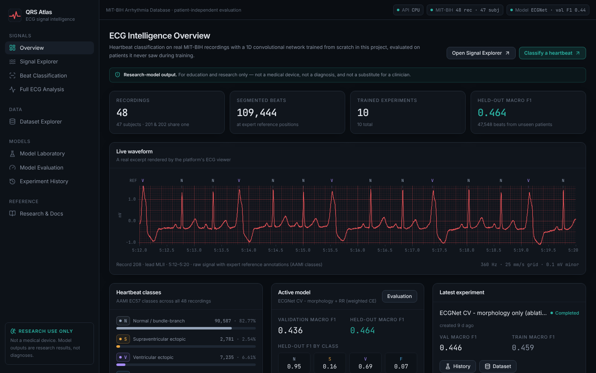
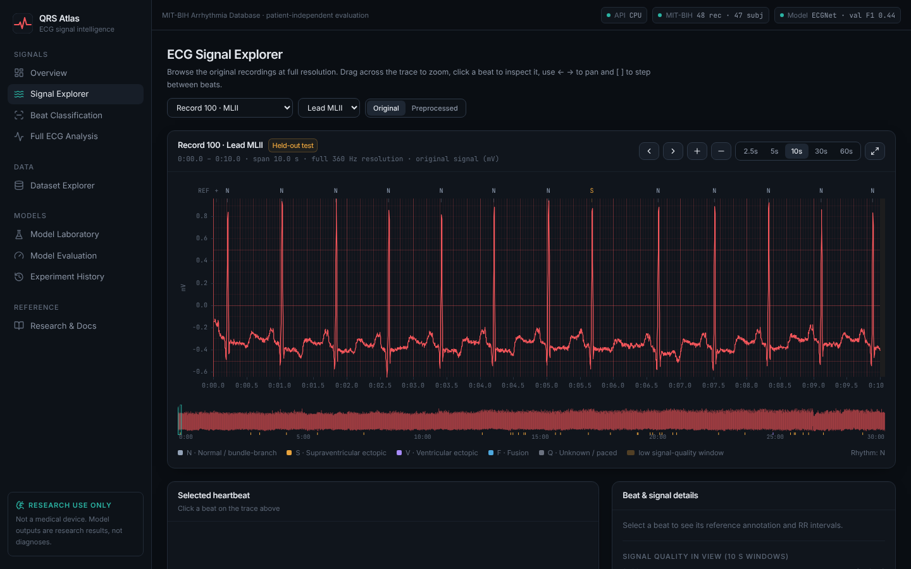
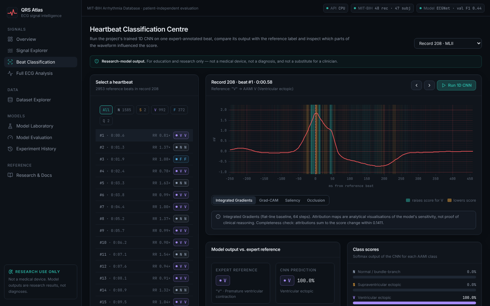
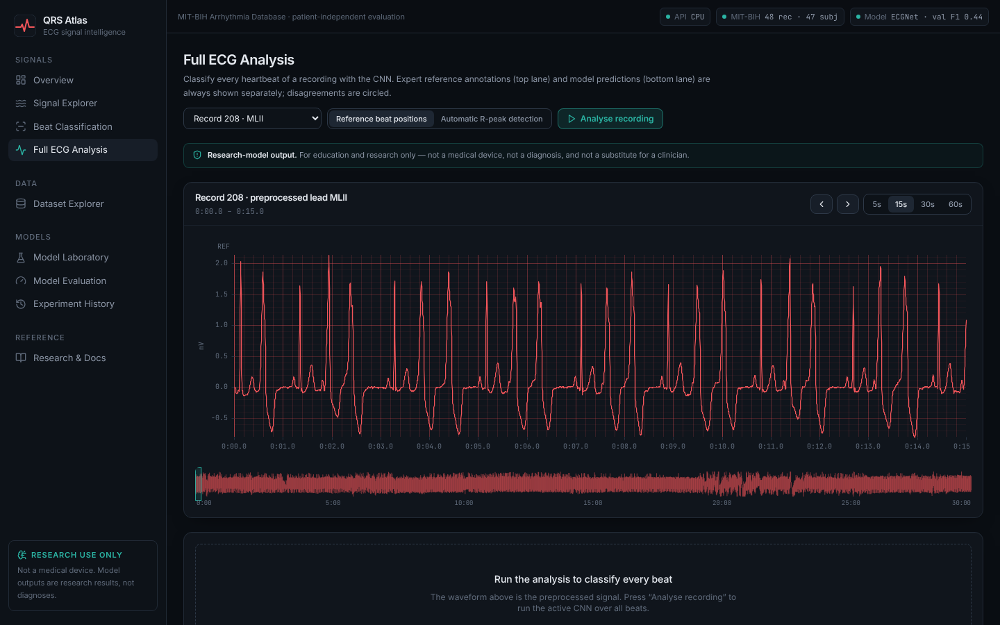
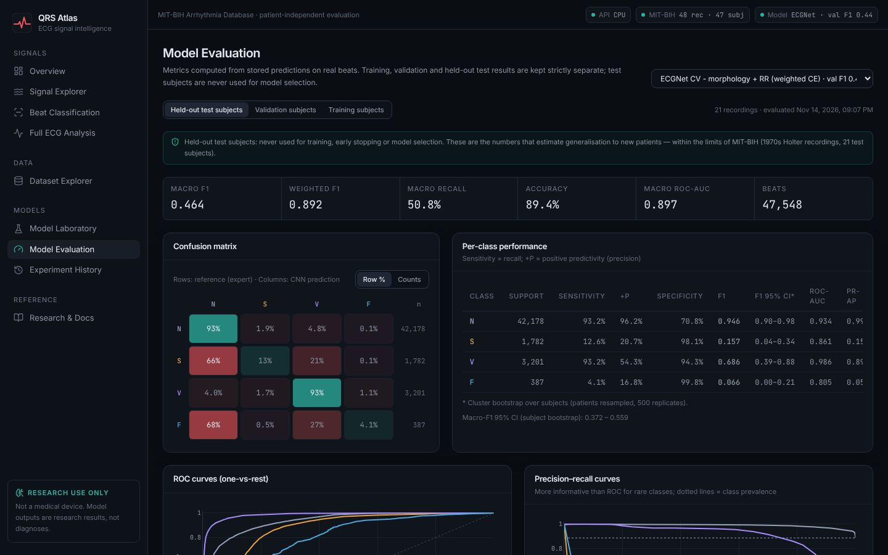
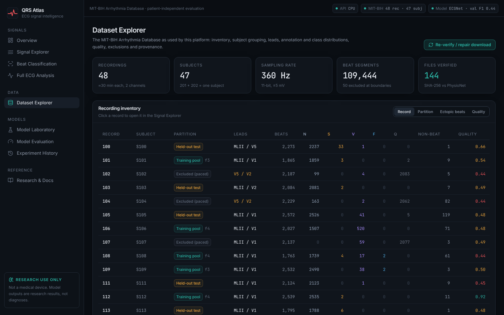

# QRS Atlas: patient-independent ECG heartbeat classification

A locally run research platform that classifies heartbeats from the real **MIT-BIH
Arrhythmia Database** with a **1D convolutional neural network trained from scratch in this
project**, evaluated on patients the model has never seen.

> **Research and education only.** QRS Atlas is not a medical device, has not been clinically
> validated, and its outputs are not diagnoses. Do not use it to assess anyone's heart,
> monitor patients or make treatment decisions. See [docs/LIMITATIONS.md](docs/LIMITATIONS.md).

## What it does

1. Downloads MIT-BIH v1.0.0 from PhysioNet and verifies all 144 record files against the published SHA-256 checksums.
2. Loads the WFDB signals (`.dat`/`.hea`) and expert annotations (`.atr`), using the MLII lead identified by header name.
3. Removes baseline wander (200 ms + 600 ms median filters) and noise (zero-phase 45 Hz low-pass).
4. Cuts one 256-sample window (90 before + 166 after) around every expert beat position and adds RR-interval features.
5. Maps MIT-BIH symbols to AAMI EC57 classes (N, S, V, F, Q) through an explicit, documented table.
6. Splits strictly **by subject**, using the DS1/DS2 inter-patient protocol corrected so that records 201 and 202 (same person) stay together, with automated leakage tests.
7. Trains **ECGNet**, the project's own 1D CNN (≈171k parameters, random initialisation, no pretrained weights), plus baseline models.
8. Evaluates on held-out subjects: confusion matrix, per-class sensitivity, precision, specificity and F1, macro and weighted F1, ROC and precision–recall curves, per-patient results, subject-bootstrap confidence intervals and inference time.
9. Explains individual predictions with Integrated Gradients, Grad-CAM, saliency and occlusion, plus a randomisation sanity check.

## Screenshots

| Overview | Signal Explorer |
|---|---|
|  |  |
| **Beat Classification** (CNN output + Integrated Gradients) | **Full ECG Analysis** |
|  |  |
| **Model Evaluation** | **Dataset Explorer** |
|  |  |

## Tech stack

| Layer | Technology |
|---|---|
| Machine learning | PyTorch (1D CNN, trained from scratch), scikit-learn (baselines), NumPy, SciPy |
| Data | WFDB (PhysioNet signal format), pandas + Parquet, memory-mapped NumPy arrays |
| Backend | Python 3.11–3.13, FastAPI, Pydantic, SQLAlchemy + SQLite, Uvicorn |
| Frontend | React 18, TypeScript, Vite, Tailwind CSS, TanStack Query, uPlot, Plotly |
| Testing | pytest, Vitest + Testing Library, Playwright end-to-end tests |
| Deployment | Docker (single image), Render / Fly.io / Railway configs, Windows and Linux CI on GitHub Actions |

## Results on held-out patients

**Evaluation protocol.** Inter-patient (subject-level) split: the de Chazal et al. (2004) DS1/DS2
protocol, corrected so that records 201 and 202 (same person) are both on the training side. The test
set is 21 subjects (47,548 beats from MIT-BIH records 100–234, lead MLII, paced records excluded). No
test subject was used for training, early stopping or model selection. The model was selected by
5-fold subject-grouped cross-validation on the training pool. Task: 4-class beat classification
(AAMI N, S, V, F) at the expert-annotated beat positions; metrics are pooled over all test beats.
Full tables, per-patient breakdown and the test-access log are in [docs/RESULTS.md](docs/RESULTS.md).

| Model | Macro-F1 (95% CI, patient bootstrap) | Accuracy | S sensitivity | V sensitivity |
|---|---|---|---|---|
| **ECGNet (1D CNN, this project)** | **0.464 (0.372–0.559)** | 89.4% | 12.6% | 93.2% |
| Random forest (RR + morphology) | 0.409 (0.317–0.524) | 82.6% | 15.5% | 96.6% |
| Logistic regression (RR only) | 0.405 (0.336–0.456) | 76.1% | 10.9% | 69.9% |
| Majority class ("always N") | 0.235 | 88.7% | 0% | 0% |

The CNN has the highest macro-F1 of the four models. It finds 93.2% of ventricular (V) beats, but
only 54.3% of its V predictions are correct (positive predictivity): 2,031 normal beats were labelled
V. Supraventricular (S) and fusion (F) beats remain hard in unseen patients. One test subject (record
232) holds 1,382 of the 1,782 S beats, and only 1.3% of them are detected. In a post-hoc look at the
other 20 test subjects, S sensitivity is 51.7% (207 of 400); this is a descriptive subgroup figure,
not a pre-specified result.

Papers that split MIT-BIH by heartbeat rather than by patient (an intra-patient split) often report
over 99% accuracy, because beats from the same person appear in both training and test data (see
the survey by Luz et al., 2016, in [docs/REFERENCES.md](docs/REFERENCES.md)). Those figures are not
comparable with the ones above. These are research results on recordings made in
1975–1979, not evidence of clinical performance.

## Application pages

| Page | Purpose |
|---|---|
| Overview | Dataset, model and experiment status, live waveform, recent activity |
| Signal Explorer | Full-resolution ECG viewer: ECG paper grid, zoom and pan, minimap, reference annotations, quality, beat inspection |
| Beat Classification | Run the CNN on one beat: class scores, comparison with the reference, attribution maps |
| Full ECG Analysis | Classify a whole record (reference or automatically detected beats); reference and prediction lanes, disagreements, timeline |
| Dataset Explorer | Inventory, subjects, leads, symbol and class counts, imbalance, exclusions, leakage checks, provenance, detector evaluation |
| Model Laboratory | Configure and train the CNN or baselines on real data with live loss and F1 curves |
| Model Evaluation | All metrics by partition, curves, per-patient table, model comparison, exact split, test-access log |
| Experiment History | Every run with config, preprocessing, partitions, environment, metrics and checkpoint; side-by-side comparison; JSON export |
| Research & Docs | Background, methodology, limitations, reproducibility, references |

## Quick start (Windows)

Requirements: **Python 3.11–3.13** (python.org installer) and **Node.js 18+** (LTS). Open
PowerShell in the project folder:

```powershell
powershell -ExecutionPolicy Bypass -File .\setup.ps1
```

```powershell
powershell -ExecutionPolicy Bypass -File .\start.ps1
```

| Address | What |
|---|---|
| <http://localhost:5173> | Application |
| <http://localhost:8000> | API |
| <http://localhost:8000/docs> | Interactive API documentation |

Stop everything with:

```powershell
powershell -ExecutionPolicy Bypass -File .\stop.ps1
```

`setup.ps1` installs the CPU build of PyTorch by default. Add `-Cuda` for an NVIDIA GPU, or
`-SkipData` to download the dataset later from the Dataset Explorer. It never trains a model.
The trained models in `models/` (with their full metric history) are imported automatically
on first start.

## Quick start (Linux / macOS)

Requirements: Python 3.11–3.13 and Node.js 18+.

```bash
./setup.sh          # venv, CPU PyTorch, requirements, MIT-BIH download + verification, npm ci
./start.sh          # backend on :8000 and frontend on :5173; Ctrl+C stops both
```

Open <http://localhost:5173>. Use `./setup.sh --skip-data` to download the dataset later from
the Dataset Explorer. If port 8000 or 5173 is already used by another program, pick other ports:
`QRS_BACKEND_PORT=8001 QRS_FRONTEND_PORT=5174 ./start.sh`.

End-to-end browser tests (with the app running):

```bash
cd frontend && npx playwright install chromium && QRS_FRONTEND_URL=http://127.0.0.1:5173 npm run e2e
```

## Manual start (any OS)

```bash
python -m venv .venv && . .venv/bin/activate
pip install torch==2.15.0 --index-url https://download.pytorch.org/whl/cpu
pip install -r backend/requirements.txt
cd backend && python -m app.cli download && python -m app.cli init-db
uvicorn app.main:app --host 127.0.0.1 --port 8000
```

In a second terminal:

```bash
cd frontend && npm ci && npm run dev
```

## Architecture

```
React + TypeScript + Vite + Tailwind  (uPlot ECG viewer, Plotly analytics charts)
          │  /api (Vite proxy)
FastAPI + Pydantic ──── SQLite (SQLAlchemy): experiments, epochs, evaluations, test-access log
   │
   ├─ data/        PhysioNet download, SHA-256 verification, WFDB loading, subject map
   ├─ signal/      filtering, quality profiling, Pan-Tompkins-style R-peak detector
   ├─ labels/      AAMI EC57 mapping
   ├─ segmentation/ beat windows + RR features → memory-mapped float32 array + Parquet metadata
   ├─ splits/      subject-level partitions, CV folds, leakage checks
   ├─ models/      ECGNet (PyTorch), baselines (scikit-learn)
   ├─ training/    worker process, live metrics, checkpoints, experiment export/import
   ├─ evaluation/  metrics, subject bootstrap
   ├─ explain/     IG, Grad-CAM, saliency, occlusion, sanity check
   └─ inference/   single-beat and whole-record classification
```

Waveforms use uPlot rather than Plotly. A record is 650,000 samples per channel, and a canvas
renderer with min/max decimation keeps zoom and pan smooth while still drawing a true ECG paper
grid. Plotly is used for analytical charts.

## Folder structure

```
backend/        FastAPI app (app/), tests/, scripts/, requirements.txt
frontend/       React app (src/), Vitest unit tests, Playwright e2e tests (e2e/)
configs/        aami_mapping.json, splits.json
models/         trained checkpoints + experiment.json records + selection.json
data/           raw MIT-BIH (read-only), processed beats, SQLite DB   (not committed)
docs/           DATASET, METHODOLOGY, RESULTS, LIMITATIONS, REFERENCES
setup.ps1 start.ps1 stop.ps1   Windows scripts
setup.sh start.sh              Linux / macOS scripts
Dockerfile render.yaml fly.toml railway.json   single-image deployment
.github/workflows/windows.yml   Windows CI: setup → tests → start → e2e → stop
.github/workflows/linux.yml     Linux CI: setup.sh → pytest → Vitest → build → start.sh → e2e
```

## Reproducing the experiments

```bash
cd backend
python scripts/run_experiments.py   # baselines + CNN variants (validation fold)
python scripts/select_model.py      # 5-fold subject-grouped CV model selection
```

Held-out test evaluation is a separate, logged action: use the "Evaluate on held-out subjects"
button on the Model Evaluation page, or `POST /api/experiments/{id}/evaluate-test`. Results are
in [docs/RESULTS.md](docs/RESULTS.md).

## Tests

```bash
cd backend && pytest                  # unit, leakage, real-data integrity, API, real training job
cd frontend && npm test               # Vitest
cd frontend && npm run e2e            # Playwright (needs backend + frontend running)
```

## Documentation

- [Dataset, acquisition, licence, citation](docs/DATASET.md)
- [Scientific methodology](docs/METHODOLOGY.md)
- [Results](docs/RESULTS.md)
- [Limitations and safety](docs/LIMITATIONS.md)
- [Deployment (Docker, Render, Fly.io, Railway, Hugging Face)](docs/DEPLOYMENT.md)
- [References](docs/REFERENCES.md)

## Limitations

- Trained and tested on one database recorded in 1975–1979 (48 recordings, 47 people, one Boston
  hospital); results may not transfer to other devices, leads, populations or wearables.
- Only 21 test subjects, so the confidence intervals are wide and minority-class results depend on
  a few patients.
- Supraventricular (S) and fusion (F) beats are poorly detected in unseen patients, and about half of
  the CNN's V predictions are false positives (see results above).
- The headline metrics use the expert-annotated beat positions. Errors from automatic R-peak detection
  are measured separately and are not included in them.
- It classifies individual beats; it does not diagnose rhythms or conditions, has no clinical
  validation and has never been compared with doctors reading the same ECGs.
- Full discussion: [docs/LIMITATIONS.md](docs/LIMITATIONS.md).

## Licence

Source code: [MIT](LICENSE). The dataset is not redistributed in this repository.

## Data licence and citation

MIT-BIH Arrhythmia Database, PhysioNet, ODC-By 1.0. Please cite Moody & Mark (2001) and
Goldberger et al. (2000); full references are in [docs/DATASET.md](docs/DATASET.md).
